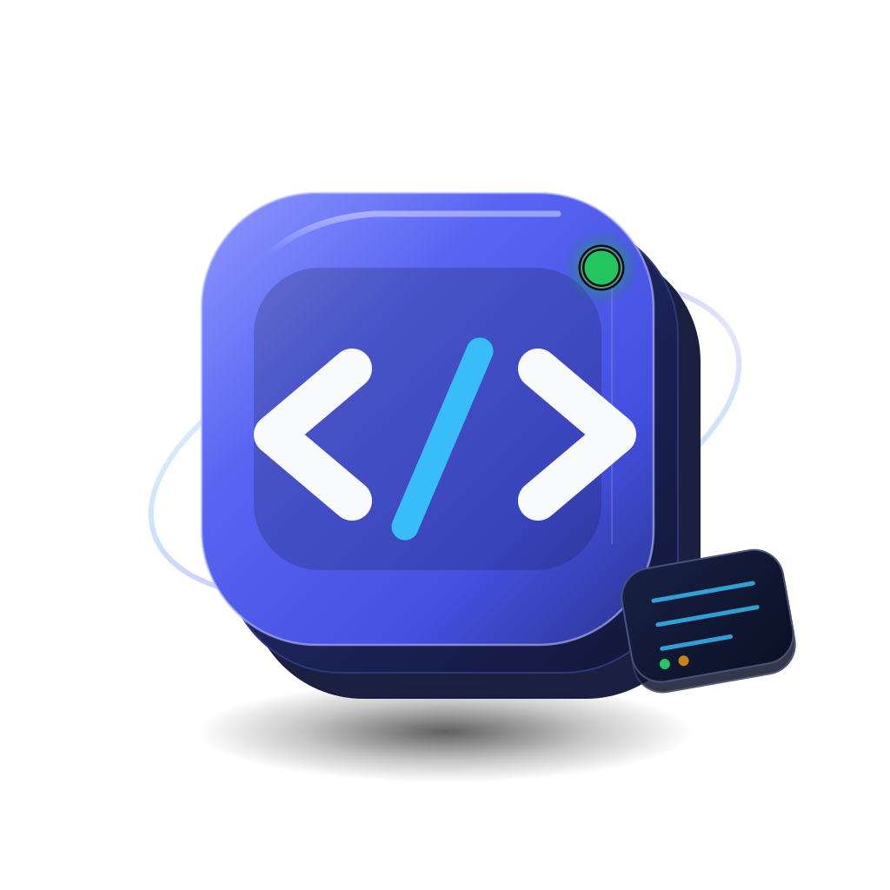
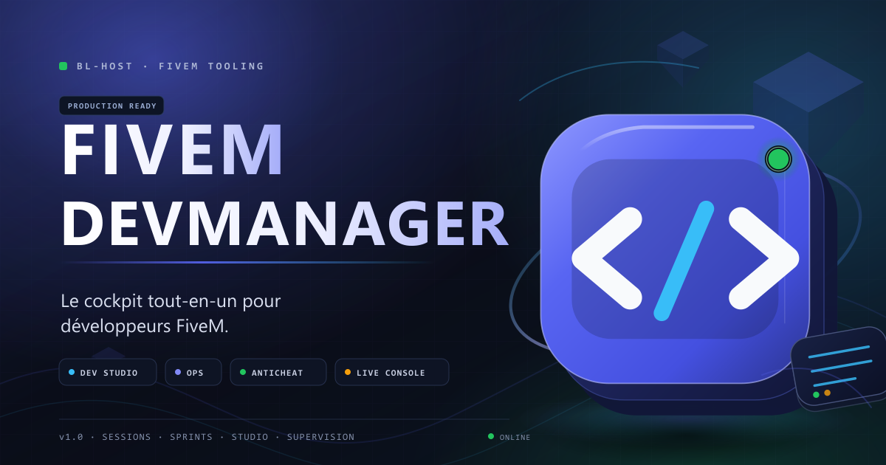

# FiveM DevManager — Code source et documentation

Code source et documentation technique publique de **FiveM DevManager**, une plateforme auto-hébergée pour développer, gérer et superviser un serveur FiveM.

> **État du projet :** le code, le build et les tests sont prêts. Le site public `https://bl-host.site` n'est pas encore déployé ; il affiche encore la page par défaut de l'hébergeur. Le fichier `.env` publié est un modèle vide : ce dépôt ne contient aucun secret d'exploitation.

## Aperçu

<p align="center">
  
</p>

[](assets/video/fivem-devmgr-teaser-vertical.mp4)

**▶ Teaser vertical 15 s** — MP4, 1080 × 1920, sans audio · [Ouvrir la vidéo](assets/video/fivem-devmgr-teaser-vertical.mp4) · [Télécharger](https://github.com/NXT-DEVOFF/fivem-devmanager/raw/main/assets/video/fivem-devmgr-teaser-vertical.mp4)

**Présentation 16:9** — [Ouvrir la vidéo](assets/video/fivem-devmgr-presentation.webm) · [Télécharger](https://github.com/NXT-DEVOFF/fivem-devmanager/raw/main/assets/video/fivem-devmgr-presentation.webm)

> GitHub n'affiche pas les MP4 du dépôt dans un lecteur intégré au Markdown. La miniature ci-dessus sert de bouton de lecture et ouvre le lecteur GitHub ; les fichiers restent téléchargeables. Tous les visuels et vidéos sont documentés dans [assets/README.md](assets/README.md).

## Sommaire

- [Architecture](docs/ARCHITECTURE.md)
- [Installation Pterodactyl / LumenWeb](docs/INSTALL.md)
- [Configuration](docs/CONFIGURATION.md)
- [Déploiement LWS + Cloudflare](docs/DEPLOY-LWS-CLOUDFLARE.md)
- [Utilisation du panel](docs/USAGE.md)
- [Administration et permissions](docs/ADMINISTRATION.md)
- [Intégrations externes](docs/INTEGRATIONS.md)
- [Sécurité](docs/SECURITY.md)
- [Dépannage](docs/TROUBLESHOOTING.md)
- [Checklist de mise en ligne](docs/CHECKLIST.md)

## Présentation

FiveM DevManager centralise :

- le cockpit temps réel et la supervision Pterodactyl ;
- les sessions, sprints, tâches, bugs et rapports ;
- les fichiers distants, l'éditeur Monaco et les déploiements ;
- les joueurs, sanctions, événements et l'anticheat ;
- FiveM Studio : véhicules, MLO, mappings et générateurs ;
- les patch notes et les webhooks Discord.

Le panel ne simule pas les intégrations : une connexion non configurée renvoie une erreur explicite.

## Fonctionnalités principales

### Pilotage

- Dashboard avec santé, KPI, sprint, incidents et activité en direct.
- Sessions chronométrées côté serveur, pauses et rapports PDF.
- Sprints, incidents `INC-xxxx`, maintenance et registre de bugs.
- Tâches en kanban avec checklist, dépendances, pièces jointes et validation par critères.
- Statistiques et journal d'audit.

### Développement

- Explorateur de fichiers Pterodactyl et fallback SFTP.
- Éditeur Monaco local, multi-onglets, autosave, diff, snippets FiveM.
- Snapshot avant écriture, verrou par fichier et détection de conflit.
- Synchronisation et détection des modifications distantes.
- Déploiements avec approbation, snapshot et rollback.
- Console temps réel et terminal selon permissions.

### FiveM Studio

- Catalogue de 118 outils.
- Debug et génération de handling véhicule.
- Constructeur MLO et builder 3D Three.js.
- Carte des mappings, coordonnées et projets CodeWalker.
- Générateurs ESX / QBCore / ox / standalone.

### Communauté

- Fiches joueurs et historique de sanctions.
- Anticheat serveur autoritatif, en mode rapport, avec heartbeat.
- Planning d'événements et suivi des places.

### Communication

- Patch notes internes ou publiques.
- Publication Discord avec idempotence.
- Base de connaissances et documentation FiveM intégrée.

## Stack

| Couche | Technologie |
|---|---|
| Frontend | Next.js 15, React 19, TypeScript, Tailwind CSS |
| Backend | Route Handlers Next.js, services TypeScript |
| Temps réel | Socket.IO sur le serveur HTTP custom |
| Base | MariaDB 10.11+ / MySQL 8+ avec Prisma |
| Auth | Sessions serveur, cookie HttpOnly, argon2id, TOTP |
| Fichiers | API Pterodactyl, fallback SFTP |
| Tests | Vitest |

## Démarrage rapide

Prérequis : **Node.js >= 20.11**, **MariaDB 10.11+ / MySQL 8+**.

```bash
npm install
cp .env.example .env
npm run secret:generate
npm run db:migrate
npm run db:seed
npm run dev
```

Ouvrir `http://localhost:3000`, se connecter avec le compte `SEED_ADMIN_*`, changer le mot de passe et activer la 2FA.

Consulter [INSTALL.md](docs/INSTALL.md) pour la procédure complète et [CONFIGURATION.md](docs/CONFIGURATION.md) pour les variables.

## Code source

Le dépôt contient le code de l'application et ses composants principaux :

- `src/` : interface Next.js, routes API, services serveur et temps réel ;
- `prisma/` : schéma, migrations et seeds ;
- `fivem-resources/fdm-anticheat/` : agent anticheat FiveM en mode rapport ;
- `public/` : visuels, carte GTA V et teaser vidéo utilisés par le panel ;
- `scripts/`, `tests/` : vérifications et tests.

Le fichier `.env` versionné est un **modèle public vide**. Il ne contient ni mot de passe, ni token, ni clé. Pour travailler, renseigner les valeurs dans un `.env` local non versionné.

Le panel ne dépend d'aucun serveur de licence externe. Les scripts d'exploitation internes (`deploy/`) ne sont pas publiés dans ce dépôt.

## Variables essentielles

| Variable | Rôle |
|---|---|
| `APP_URL` | Origine publique exacte, sans slash final |
| `DATABASE_URL` | Connexion MariaDB/MySQL |
| `APP_ENCRYPTION_KEY` | Chiffrement AES-256-GCM des intégrations |
| `APP_SECRET` | Secret de session |
| `SEED_ADMIN_*` | Compte administrateur initial |
| `ANTICHEAT_INGEST_TOKEN` | Token Bearer de l'agent anticheat |

Le `.env` du dépôt est un modèle vide : ne jamais y ajouter de vraie valeur. Les clés Pterodactyl, SFTP et Discord se configurent dans l'interface et sont chiffrées en base.

## Déploiement

Le projet nécessite un processus Node persistant, des WebSockets et une base MariaDB/MySQL. Un hébergement PHP mutualisé classique ne suffit pas.

Deux parcours sont documentés :

- **Pterodactyl / LumenWeb** : [INSTALL.md](docs/INSTALL.md) ;
- **VPS LWS + Cloudflare** : [DEPLOY-LWS-CLOUDFLARE.md](docs/DEPLOY-LWS-CLOUDFLARE.md).

Après déploiement :

```bash
curl -fsS https://<domaine>/api/health
curl -fsS https://<domaine>/api/readyz
```

`/api/readyz` doit répondre **200** lorsque la base et la configuration sont prêtes.

## Sécurité

- Sessions serveur, cookie `HttpOnly`, `SameSite=Lax`, `Secure` en production.
- Permissions vérifiées côté serveur sur chaque route.
- Protection CSRF, validation Zod, CSP et `X-Frame-Options`.
- Secrets chiffrés avec AES-256-GCM.
- Snapshots et contrôle de concurrence avant écriture.
- Journal d'audit immuable.

Voir [SECURITY.md](docs/SECURITY.md).

## Documentation complémentaire

La version Notion contient les guides détaillés d'installation, de déploiement, d'utilisation et d'exploitation. Ce dépôt GitHub publie le code source et la documentation technique versionnable ; il ne contient ni secrets, ni tokens, ni données d'exploitation.

## Licence

Le projet est distribué sous **AGPL-3.0-only**. Voir [LICENSE](LICENSE) et [NOTICE](NOTICE). Les composants tiers sont listés dans [NOTICES.md](NOTICES.md).

## Contribution

Les corrections de code et de documentation sont bienvenues via une offre de pull request. Ne jamais inclure de secrets, de tokens, d'adresses internes, de journaux d'exploitation ou de données personnelles dans une contribution.
